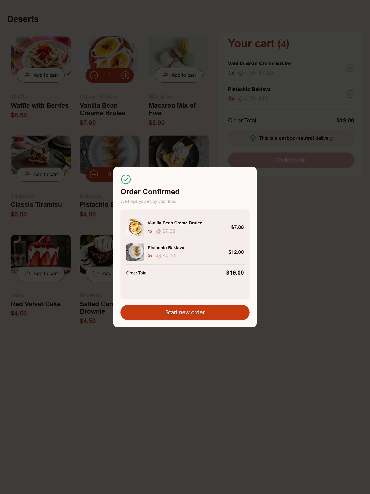
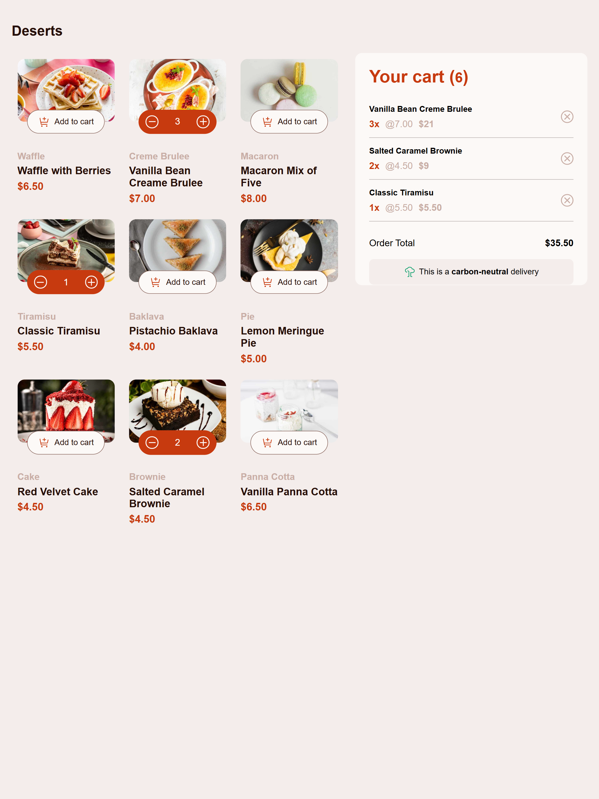
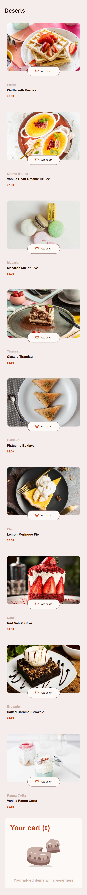

# Frontend Mentor - Product list with cart solution

This is a solution to the [Product list with cart challenge on Frontend Mentor](https://www.frontendmentor.io/challenges/product-list-with-cart-5MmqLVAp_d). Frontend Mentor challenges help you improve your coding skills by building realistic projects. 

## Table of contents

- [Overview](#overview)
  - [The challenge](#the-challenge)
  - [Screenshot](#screenshot)
  - [Links](#links)
- [My process](#my-process)
  - [Built with](#built-with)
  - [What I learned](#what-i-learned)
  - [Continued development](#continued-development)
  - [AI Collaboration](#ai-collaboration)
- [Author](#author)
- [Acknowledgments](#acknowledgments)

## Overview

This project is my solution to the Product List with Cart challenge from Frontend Mentor.

It is a responsive dessert shopping interface that allows users to browse products, add items to their cart, adjust quantities, remove items, and view their order summary.

Users can also confirm their orders through an order confirmation modal or start a new order, which resets the cart.

### The challenge

Users should be able to:

- Add items to the cart and remove them
- Increase/decrease the number of items in the cart
- See an order confirmation modal when they click "Confirm Order"
- Reset their selections when they click "Start New Order"
- View the optimal layout for the interface depending on their device's screen size
- See hover and focus states for all interactive elements on the page.

All the required features have been successfully implemented.

### Screenshot

#### Desktop modal view

#### Desktop view

#### Mobole view

### Links

- Solution URL: [Solution URL](https://github.com/Deen-www/Product-list)
- Live Site URL: [Live site URL](https://deen-www.github.io/Product-list/)

## My process
Studied the frontendmentor designs and requirement. set up the project file and structure.

Used Html to create products list, cart and order confirmation modal.

Used CSS to recreate the designs, add hover effect and made the layout responsive.

Used JavaScript for interactive, and implement the shopping cart.

### Built with

- Semantic HTML5 markup
- CSS custom properties
- Flexbox
- CSS Grid
- Mobile-first workflow
- JavaScript

### What I learned
I learned how ".toFixed(2)" is been used for numbers that already has a decimal place, rather than hardcode ".00" numbers. 

I used the methood to fixed individual product prices, product subtotal and overall cart total.

### Continued development
Areas i would want to continue focusing on is how to make used of one created empty array in many occasion. 

for this project, i created a cart array outside the "add to cart event listener" because i needed to make use of it not only for "add to cart event listener," but where needed. it should serve as a single source of truth.

inside the empty array is an object created when a user click on add to cart.

### AI Collaboration

I used AI as my assistance and my favourite is chatgbt.
As a self taught developer, ChatGPT has been my mentor. I dont copy code, I understant, learn and practice until it feel natural, untill i can code it without asking for help.
curiousity is my biggest weapon.

Going back to this project, when i get to "Order confirmation modal in JS." the only diffrence from display selected products in cart array and modal is the thumbnail image for each of the selected products. I realised i neded to make use of the created array to get the products info, but the array doesnt contain the product images. then i consult AI, and then realised i need to store the product image path as part of the object.

At some cases i also use it for debugging.

## Author
- Frontend Mentor - [Deen-www](https://www.frontendmentor.io/profile/Deen-www)
- Linkedln - [Salaudeen Alhaji](https://www.linkedin.com/in/salaudeen-alhaji-374a1b425?utm_source=share_via&utm_content=profile&utm_medium=member_android)

## Acknowledgments

Shout out to myself for completing this project. Some days i felt like to give up, but something kept me going even if i dont feel like. something that kept me in check, the mindset "I must do this, if others can why can't I!"
